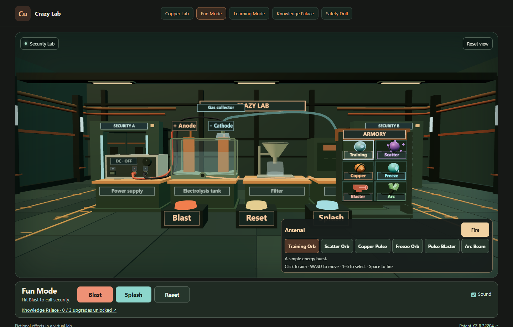

# Crazy Lab

**Early beta · 3D learning platform**

Crazy Lab is a browser game about copper. Dig ore out of rock, follow the metal into a powder lab and try the powder in working exhibits. The home page also opens hands-on electrochemistry lessons and a robot shooter.

[Play Crazy Lab](https://crazy-lab.onrender.com/) · [Fun Mode mechanics](#fun-mode)

This public source snapshot contains the application submitted for the capstone, identified by release `b8754c7`. The README expands on how the arcade works.

## Why I built it

School chemistry can feel abstract and dry when lessons are mostly definitions and equations, with few chances to try an experiment yourself. Electrochemistry is especially hard to picture when you've never seen what happens at the plates inside a tank.

I started Crazy Lab as a solo AR/VR capstone project to give beginners that experience. Switch on a mini tank and look for bubbles. Tap the filter and watch the liquid drain while the grains stay behind. Each action gives you something to notice and a short explanation of why it happened. The first module follows a copper-containing solid from the tank to the reactor, where it becomes copper powder. The lab model draws on [Kazakhstan patent KZ B 32204](https://gosreestr.kazpatent.kz/Gosreestr/DownloadDescription?documentId=1614379).



## Start on the home page

The [home page](https://crazy-lab.onrender.com/) introduces the project and links directly to its activities. Choose **Present** for a short [site overview](https://crazy-lab.onrender.com/?present=1). Use the arrow keys to advance and **Esc** to return to the page. The separate capstone slides are designed for the six-minute talk before the live demonstration.

- **Discover Copper.** Strike a flecked block in Copper Quarry. Walk up to the concentrator, smelter, and refiner for Pip's explanations, then run each machine and watch what it produces. Choose **Enter the powder lab** after collecting refined copper, then **Enter the exhibition** when your powder is ready. Each finished stage has a short cheer and fireworks. Watch all three exhibits for the biggest finale. The route bar opens any stop directly.
- **Chemistry Made Simple.** Start by switching on a tank and looking for the plate that bubbles. Next, move a tiny particle called an electron and see how the charge changes. Finally, open a drain and find where the solid grains stay. **Inside the lab** lets you use what you observed to make copper powder at your own pace.
- **Fun Mode.** Enter the arcade lab, trigger the alarm and face three waves of security robots.

Pip, a little copper-colored field guide, comments on discoveries in the quarry, lab and exhibition. Open **? Ask a question** to ask about the current activity or **Past comments** to revisit a discovery in the same tab. In the hosted edition two AI models explain ideas from reviewed learning material on the game server. Players can switch to the built-in guide in the chat. The static edition uses the bundled lesson notes. A separate invitation-only beta offers Gemini.

The powder exhibition is a quiet 3D gallery with three interactive displays. Drag to look around or focus the room and walk with WASD or the arrow keys. Selecting an exhibit starts the experiment from where you stand. The controls below the room also work with a keyboard or touch. At the oil exhibit, run the two matched tests and zoom in on the wear marks. On compatible WebXR devices, **Enter VR** opens the room and the controller selects exhibits. Illustrated displays are available when WebGL cannot start.

### Individual activities

| Mode | What you do |
| --- | --- |
| [Knowledge Palace](http://127.0.0.1:8791/?mission=crazy&mode=palace) | **Try the basics.** Pop bubbles, see what a filter catches and move an electron to see how charge changes. Each short experiment is replayable. |
| [Learning Mode](http://127.0.0.1:8791/?mission=crazy&mode=learning) | **Run the virtual lab.** Click the equipment to follow gas through the tube, separate the grains and make copper powder in seven steps. Use **How it works**, **Lab words** or **Ask the guide** when you want more detail. |
| [Copper Quarry](http://127.0.0.1:8791/?mission=crazy&mode=quarry) | **Mine, build and process ore.** Dig through a finite voxel map, use mined blocks to build steps and make refined copper at three stations. |
| [Powder Exhibition](http://127.0.0.1:8791/?journey=discover&stage=uses) | Hover or focus to read about a use. Click, tap or press Enter to try it. Each display links to the experiment behind it. |
| [Safety Drill](http://127.0.0.1:8791/?mission=crazy&mode=safety) | **Practise lab decisions.** Make four choices, get a score and read a short explanation with sources for each decision. |
| [Fun Mode](http://127.0.0.1:8791/?mission=crazy) | **Play an arcade round.** Hit a device or press **Blast** to call security. Move or build cover with chairs and boxes. Disable all 12 robots across three waves to win and trigger fireworks. |

## Fun Mode

[Launch Fun Mode](https://crazy-lab.onrender.com/?mission=crazy). This optional first-person arcade mode turns the laboratory into an arena. Its accidents and damage effects are fictional.

### Alarm, waves and shield

Hit a piece of equipment or use **Blast** to trigger the lab alarm. Press **R** to start a round directly. The two security bays open and release **three waves of 2, 4 and 6 robots**. Later waves move faster and the final wave includes armored robots. The HUD tracks your shield, current wave and number of robots disabled. It restores up to 20 shield points between waves. Disable all 12 robots for the victory sequence.

Press **M** or select **Stop siren** when the alarm is sounding. The siren stops and sprinklers run for a few seconds while the robots continue the round. After silencing the alarm or finishing a round, use **Reset** to restore the room and clear damage. If the shield reaches zero, the round ends.

### Cover and movable objects

Chairs, boxes, the copper plates and loose robot parts can be picked up, placed or thrown. Stack boxes or chairs to create cover and build a perch. The robots route around walls, equipment and placed furniture. You can interrupt an approaching strike by getting onto high ground. Each strike has a visible wind-up.

Aim a held box at a green placement marker to put it down. Aim into open space and click to throw it. A flying object can hit several robots before it lands. Boxes damage and stun robots on impact, while a direct chair or copper-plate hit disables them. Disabled robots break into pieces, and you can pick up the pieces once they settle. A chair shows a crack after its second impact and breaks after its third.

### Breakable equipment and arsenal

The power supply, tank, filter and reactor each respond to hits. The tank shatters and leaks when broken. Thrown objects make different sounds depending on the material and the surface they hit. Orbs can leave scorch marks that fade after about 30 seconds.

The six basic weapons are Training Orb, Scatter Orb, Copper Pulse, Freeze Orb, Pulse Blaster and Arc Beam. The armory also offers a pistol, carbine and shotgun with different in-game firing patterns and unlimited ammunition. You can use the hammer or find the crowbar on the right workbench.

### Desktop controls

| Input | Action |
| --- | --- |
| **WASD** or arrows, **Space** | Move and jump |
| Drag, or choose **Capture mouse** | Look around. Adjust camera sensitivity in the menu. |
| **Q** | Cycle through available weapons |
| **1–9** | Select a slot. The bar has six basic weapon slots and three slots for picked-up objects. |
| **X**, **V**, **B** | Fire, strike up close, or grab and swing the hammer or copper plate |
| **E**, **G**, **F**, **Z** | Pick up, throw, place or drop the selected object |
| **R**, **M**, **P**, **N** | Start a round, silence the siren, pause or open the menu and release the mouse |

### Rewards from the Knowledge Palace

All six base weapons are available when you start. The first completion of each Palace experiment adds one point and automatically unlocks its own upgrade in the Fun Mode menu (**N**). Progress is saved in your browser. Replaying an experiment lets you practise it again at the same point total.

| Experiment | Upgrade unlocked in Fun Mode |
| --- | --- |
| Find the bubbles | Scatter Nova |
| Catch the grains | Copper Surge |
| Move the electron | Deep Freeze |

The code for waves and robot behavior is in [fun-encounter.js](dist/fun-encounter.js). [fun-furniture.js](dist/fun-furniture.js) handles carrying, placement and throws. [fun-damage.js](dist/fun-damage.js) controls equipment damage and its visual effects.

## Run the public edition locally

Use Node.js 22 or later and a WebGL-capable browser. Three.js is included in the repository. On Windows, open `start.cmd`, or run this from the project folder:

```sh
node server.mjs
```

Open the [Crazy Lab home page](http://127.0.0.1:8791/) after the server starts. The mode links above work on the computer running the server. You can also open the same address in another browser on that computer. Each browser has its own Palace progress.

In **Copper Quarry**, move with **WASD** or the arrow keys and jump with **Space**. Drag the scene to look around or choose **Capture mouse** to turn freely. Press **N** or **Esc** to free the cursor. Select the pickaxe with **1**, then click or press **E** twice on the same ore block. The first blow leaves cracks. Select a mined block with **2–5** and click or press **E** or **F** to place it against the highlighted face. Placing the last block in a stack equips the pickaxe again. **Show next step** turns the camera toward the next objective. Use the on-screen controls on touch screens.

Open **5-min demo** in the top bar for a short route through the modes, including links and the controls for each stop.

Gold highlights mark the current guided action on equipment and buttons. After a lab animation, click the highlighted machine or choose **Continue** in the panel to advance. During a quiz, the whole set of choices is outlined so every answer has the same emphasis.


### Lab guide

In **Learning Mode**, open **Ask the guide**, type a question and press **Send**. The built-in guide answers supported questions from the lesson notes, links to the references and says when the lesson leaves a question open. It runs in the browser.

## Publish the AI guide on Render

Pip answers English questions using two open models running on the game server. MiniLM selects a relevant fact from reviewed public science notes. FLAN-T5 can rephrase that fact for a beginner. The chat keeps the topic and the position of the last supporting sentence for short follow-ups. The generator receives only reviewed public text. New quantities, formulas, links and technical vocabulary outside the supporting fact cannot pass its output check. The game itself credits its published source.

Open **Ask a question** and try *“What does a filter do?”*, followed by *“Can you give me an example?”*. Use **Answer style** to switch between explanations and exact passages. Replies identify the model or the study notes that supplied the text. Both models operate without API keys or an external inference provider. [FLAN-T5](https://huggingface.co/google/flan-t5-small) · [MiniLM](https://huggingface.co/onnx-community/all-MiniLM-L12-v2-qa-all-ONNX)

Deploy the repository using **New → Blueprint** in Render. The included `render.yaml` builds the model assets and starts **one free Node.js web service**. Open the public HTTPS address after Render reports **Live**. Free services can take time to wake after inactivity. For a custom domain, set `COPPER_LAB_PUBLIC_ORIGIN` to its exact HTTPS origin. [Render Blueprint setup](https://render.com/docs/infrastructure-as-code) · [Free instance limits](https://render.com/docs/free)

## Publish the built-in guide on a static host

Upload the **contents of `dist/`** to a static HTTPS host. The public learning link is `/?mission=crazy&mode=learning` on that site. The browser answers from the bundled lesson notes. This deployment requires no API key, Node.js server or Gemini quota. The default local launcher also runs with the built-in guide.

## Open Crazy Lab on Windows

With Node.js 24 installed, double-click `start-gemini.cmd`. It opens Learning Mode on this computer. You can ask Pip questions immediately. No key or invitation is required at startup or in the game. Keep the server window open while playing. [Open the running desktop lab](http://127.0.0.1:8793/?mission=crazy&mode=learning)

**Optional private Gemini for an eligible adult.** Run `setup-gemini.cmd` once in your own Windows account to add your personal Gemini API key. Windows encrypts it for that account and stores it at `%LOCALAPPDATA%\CrazyLab\gemini.dpapi`. A configured `GEMINI_API_KEY` environment variable takes priority. Restart the desktop lab after changing the key. The browser opened by the desktop launcher can use Gemini and retains the built-in guide as a fallback. To remove your saved key, delete `gemini.dpapi` and restart the desktop lab.

## Host the private Gemini beta

Use Node.js 24. Issue a different random invitation code to each tester you have confirmed is 18 or older. Give codes only to eligible testers in supported regions. Keep the beta on a separate origin from the public edition. [Gemini API terms](https://ai.google.dev/gemini-api/terms), [supported regions](https://ai.google.dev/gemini-api/docs/available-regions)

Generate an invitation code in a local terminal:

```sh
node -p "require('node:crypto').randomBytes(18).toString('base64url')"
```

Invited testers enter their personal code on the hosted beta. In **Ask a question**, Gemini is selected automatically. You can switch to the built-in guide or try *Can you explain how the filter works using a kitchen example?* A reply labeled **Gemini** confirms a response from the provider.

For hosting, run a single process with `node server.mjs --beta` behind HTTPS. The HTTPS proxy should preserve the public `Host` header. Configure the following in the hosting dashboard:

| Setting | Value |
| --- | --- |
| `GEMINI_API_KEY` | New API key, stored as a secret. Rotate any key previously saved in a launcher. |
| `COPPER_LAB_BETA_ACCESS_CODE` | Comma-separated invitation codes, stored as a secret. Remove an entry to revoke that invitation when the server restarts. |
| `COPPER_LAB_BETA_ORIGIN` | The beta's exact HTTPS origin, for example `https://beta.example.com`. |
| `COPPER_LAB_BIND` | `0.0.0.0` when required by the host. The server reads `PORT` if the host sets it. |
| `COPPER_LAB_BETA_DATA_DIR` | A persistent directory outside `dist/`. It stores SQLite quota counters. |
| `COPPER_LAB_BETA_DAILY_LIMIT` | A rolling 24-hour site cap. Default 20. Set it below the active quota shown for the project. |

The beta admits up to three Gemini requests per invitation in ten minutes, six across the site per minute, and two at a time. Common questions use the built-in guide. Busy, quota and provider failures return local answers immediately when a limit is known. A Google rate-limit response also pauses online requests across the site. The daily cap and pause survive a server restart with the same data directory. The guide uses Gemini 3.1 Flash-Lite. [Gemini pricing](https://ai.google.dev/gemini-api/docs/pricing#gemini-3.1-flash-lite), [quota dashboard](https://aistudio.google.com/rate-limit)

Online replies send the question, recent messages and current activity to the selected provider. `start-openai.cmd` remains a separate local development launcher on port `8792`.

## Science behind the modes

The two learning labs follow the process described in [KZ B 32204](https://gosreestr.kazpatent.kz/Gosreestr/DownloadDescription?documentId=1614379), filed in 2015 and published in 2017. Copper(I) oxide settles in the tank while hydrogen from the cathode travels to a separate reactor. Filtering catches solid grains as liquid passes through. Rinsing washes away dissolved salt and drying removes moisture. In the reactor, hydrogen reacts with the oxide to make water and leave metallic copper powder. [IUPAC definition of filtration](https://goldbook.iupac.org/terms/view/F02388)

Copper Quarry compresses one common sulfide-ore route into concentration, smelting and refining. The furnace represents smelting and converting together. The ore markers, terrain and batch times are game mechanics. [USGS copper overview](https://www.usgs.gov/centers/national-minerals-information-center/copper-statistics-and-information), [EPA description of primary copper smelting](https://www.epa.gov/stationary-sources-air-pollution/primary-copper-smelting-national-emissions-standards-hazardous-air)

Fun Mode uses fictional arcade equipment, robot encounters and stylized effects.

The exhibition recreates three published experiments. One team powered an LED with a printed copper track. Another laser-printed a copper double helix from a blend of fine and larger particles. A third measured less wear when rubbing metal surfaces in an oil containing copper nanoparticles. Each team tested its own material. Suitability of powder made by KZ B 32204 for a particular application would require testing. [Printed circuit](https://www.mdpi.com/2079-4991/9/8/1071), [3D printing](https://pubmed.ncbi.nlm.nih.gov/37609581/), [friction and wear](https://www.sciencedirect.com/science/article/pii/S1567173909001369)

## Beta status

The current build is playable in a desktop browser and includes touch controls. It has one scientific topic, three short experiments and browser-local progress. Its equipment, particle sizes and timing are simplified for learning. WebXR is available on compatible setups. Physical headset testing and broader learner feedback are still ahead.

The prototype uses JavaScript, Three.js and a small Node.js server. The bundled library licence is in [LICENSE-THREE.txt](dist/vendor/LICENSE-THREE.txt).

## Capstone build record

| Item | Evidence |
| --- | --- |
| Solo project | The author owns the learning concept, game direction, chemistry scope and iteration decisions. |
| Public target | WebXR VR in the virtual lab and exhibition. Chrome keyboard/mouse and touch paths are available for the rest of the journey. |
| Tested browser | Desktop Chrome with WebGL. Layout checks at 1180, 390 and 320 px; the 3D and illustrated exhibition paths completed. |
| XR performance | Physical Quest performance has yet to be measured. Course target: 72 FPS. A software emulation test cannot establish Quest frame rate. |
| Engine and asset size | Three.js 0.186.1, pinned in the repository. Browser distribution: 3,608,805 bytes. Original animated copper-grains GLB: 3,620 bytes. Model weights are server-only and fetched separately. |
| Reproduce | From a fresh clone, run `node server.mjs` (Node.js 22+). For the neural deployment use Node.js 24 and the steps in `render.yaml`. |
| AI production disclosure | OpenAI Codex assisted with code, asset scripting, debugging, automated QA, and coursework drafting. The public in-game guide runs MiniLM with optional FLAN-T5 rewriting. |
| Sources and rights | [Copper grains asset and bundled loader licenses](docs/copper-grains-asset.md). The three route images on the home page are stills from the playable scenes. The native copper hero is a supplied project illustration. The copper foil and powder illustration and the two mode covers were generated with OpenAI ImageGen for Crazy Lab. The project author supplied the victory audio, which was edited for the game. Its third-party reuse rights have yet to be independently confirmed. Research references are linked in the Science section. |

The exhibition plays the copper-grains clip through `AnimationMixer` during **Light the LED**. Desktop WebGL checks confirmed initial playback, replay and a reduced-motion end state.
